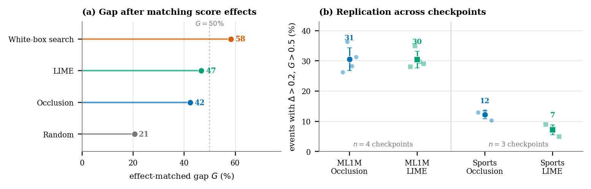

# Same Score Drop, Different Mechanism

### Auditing deletion-based explanations in neural recommenders

Mikhail Baklanov, Oren Barkan, Noam Koenigstein · WSDM 2027 · [Apache-2.0 license](LICENSE)

Deletion tests ask whether selected interactions are counterfactually
important: remove them and measure the change in the recommendation. They do
not, by themselves, show that the removed interactions supplied evidence to
the original forward pass. This repository implements a layer-relative audit
that separates removal of clean evidence from computation that becomes
score-relevant only after deletion.



At matched deletion effects, explanation methods can differ substantially in
mechanism alignment. The same pattern recurs across independently trained
SASRec checkpoints and a second sequential dataset.

## What the audit measures

For a clean activation, a deleted activation, a target item, and a small set
of competitors, the audit projects the deletion displacement onto item-score
directions available at the clean state. Replaying that displacement through
the unchanged downstream model gives

$$
\Delta = R + U,
\qquad
G = \mathrm{clip}_{[0,1]}\!\left(\frac{U}{\Delta}\right).
$$

| Quantity | Interpretation |
|---|---|
| $\Delta$ | target-score change under deletion |
| $R$ | effect reproduced through clean-state score directions |
| $U$ | deletion effect not reproduced through those directions |
| $G$ | unreproduced fraction of a positive deletion effect |

For clean-computation attribution, the desired combination is a large
$\Delta$ and a small $G$. A large value of both identifies a strong
counterfactual whose effect is poorly attributed to the clean computation at
the audited layer.

## What is included

- A controlled two-pathway recommender in which evidence removal and dormant
  route activation have identical endpoint behavior but gaps of 0 and 1.
- Audits for MultVAE, NeuMF, and SASRec, including clean, endpoint, path, and
  endpoint-union reference bases.
- Saliency, integrated gradients, LIME, occlusion, SPINRec, LXR, SHAP,
  random/popularity, behavior-only search, and white-box stress tests.
- A proof-of-concept SASRec application that runs the same local search under
  max-$\Delta$, max-$U$, and max-$R$ objectives.
- Exact architecture-specific decompositions for decoder ReLUs, NeuMF gates,
  and SASRec attention/context--FFN deviations.
- Released per-user CSVs, seed replications, robustness controls, figure
  generation, and a self-contained regression suite.

The repository intentionally excludes raw interaction data, model weights,
and training logs. Tests and all paper-level summaries run directly from the
shipped code and CSV files; full model reruns require the cited public data and
checkpoints.

## Quick start

Python 3.10+ is recommended.

```bash
python3 -m venv .venv
source .venv/bin/activate
pip install -r requirements.txt
cd code
python3 -m pytest test_jlens.py test_jlens_explainers.py \
  test_jlens_synthetic.py test_jlens_reporting.py -q
```

The current release contains 64 tests and requires no checkpoints or
interaction data for the test suite.

## Reproduce the paper outputs

From the repository root:

```bash
python3 paper/make_figures.py
python3 paper/make_tables.py jlens_results/ml1m_vae_adversarial_k10.csv
```

This regenerates the three data-backed vector figures in `paper/figures/` and
prints the paired MultVAE stress-test summary. The scripts read only the
released per-user CSVs.

<details>
<summary><strong>Reproduce the SASRec headline and checkpoint replications</strong></summary>

```bash
python3 code/analyze_sasrec_matched.py --prefix ml1m sports \
  --seeds 42 7 123 --include-published --include-published-attack
python3 code/run_jlens_sasrec_seed_sweep.py --report-only \
  --dataset Movielens-1m --prefix ml1m \
  --out jlens_results/ml1m_sasrec_seed_strong.csv
python3 code/run_jlens_sasrec_seed_sweep.py --report-only \
  --dataset Sports --prefix sports \
  --out jlens_results/sports_sasrec_seed_strong.csv
```

The matching analysis restricts all compared methods to common pooled
deletion-effect deciles before averaging within-decile median gaps. The
checkpoint summaries report the joint event $\Delta>0.2, G>0.5$.

</details>

<details>
<summary><strong>Reproduce the audit-guided SASRec selection table</strong></summary>

```bash
python3 code/analyze_sasrec_search_objectives.py
```

The shipped per-user files use the same 100 users, candidate pool,
initializations, search budget, $K=5$, and block-1 tap. The three runs differ
only in whether the search maximizes the deletion effect $\Delta$, the
unreproduced remainder $U$, or the clean-aligned effect $R$.

</details>

<details>
<summary><strong>Reproduce competitor-set sensitivity</strong></summary>

```bash
python3 code/analyze_jlens_competitor_sensitivity.py \
  --results-dir jlens_results
```

</details>

## Repository map

| Path | Purpose |
|---|---|
| [`code/jlens.py`](code/jlens.py) | core audit: taps, Jacobian directions, projection, patching, and gaps |
| [`code/jlens_explainers.py`](code/jlens_explainers.py) | explanation-method adapters |
| [`code/jlens_adversarial.py`](code/jlens_adversarial.py) | behavior-only and white-box deletion searches |
| [`code/jlens_synthetic.py`](code/jlens_synthetic.py) | controlled two-pathway construction |
| [`code/jlens_sasrec.py`](code/jlens_sasrec.py) | sequential-model audit |
| [`code/analyze_sasrec_search_objectives.py`](code/analyze_sasrec_search_objectives.py) | audit-guided selection summary and paired interval |
| [`code/run_jlens_sasrec.py`](code/run_jlens_sasrec.py) | SASRec explainers and fixed-budget searches |
| [`code/run_jlens_switch_diagnostic.py`](code/run_jlens_switch_diagnostic.py) | exact MultVAE and NeuMF decompositions |
| [`code/run_jlens_sasrec_carrier.py`](code/run_jlens_sasrec_carrier.py) | exact SASRec carrier decomposition |
| [`jlens_results/`](jlens_results/) | released per-user audit outputs |
| [`paper/`](paper/) | table and figure regeneration scripts |

The main per-user fields are:

| CSV field | Meaning |
|---|---|
| `delta_beh` | deletion effect $\Delta$ |
| `jcomp` | clean-aligned effect $R$ |
| `clean_unrecovered` | remainder $U$ |
| `clean_gap` | bounded behavior--mechanism gap $G$ |
| `symmetric_gap` | order-symmetrized gap control |
| `tap` | audited activation layer |

## Full experiment reruns

Full reruns require the corresponding interaction matrices and model
checkpoints under `processed_data/` and `check/`. The files used for the paper
are recorded in [`paper/checkpoints.sha256`](paper/checkpoints.sha256).

<details>
<summary><strong>Example commands</strong></summary>

```bash
cd code
python3 run_jlens_adversarial.py --data ML1M --model VAE \
  --k 10 --n-users 100
python3 run_jlens_switch_diagnostic.py --data ML1M --model VAE --k 10
python3 run_jlens_sasrec_basis_robustness.py \
  --ckpt <sasrec-checkpoint> --methods occlusion lime attack \
  --k 5 --n-users 100
python3 run_jlens_sasrec_carrier.py \
  --ckpt <sasrec-checkpoint> \
  --input ../jlens_results/<sasrec-basis-result>.csv
python3 run_jlens_sasrec.py --ckpt <sasrec-checkpoint> \
  --mode attack --n-users 100 --k 5 --score delta_minus_j --lam 0
python3 run_jlens_sasrec.py --ckpt <sasrec-checkpoint> \
  --mode attack --n-users 100 --k 5 --score delta_minus_j --lam 1
python3 run_jlens_sasrec.py --ckpt <sasrec-checkpoint> \
  --mode attack --n-users 100 --k 5 --score jfwd
python3 run_jlens_competitor_sensitivity.py static \
  --data ML1M --model VAE
```

MultVAE seed replications use `code/train_vae_seeds.py`; NeuMF replications
use `code/train_ncf_seeds.py`; SASRec MovieLens-1M and Amazon Sports
replications use `code/train_sasrec_seeds.py`.

</details>

<details>
<summary><strong>Exploratory LXR training (not reported in the paper)</strong></summary>

The repository retains a paired LXR credit-assignment experiment for future
work. It is not part of the paper's evidence or contributions.

```bash
python3 code/analyze_jlens_lxr_retrain.py --stage test \
  --datasets ml1m yahoo pinterest --seeds 7 42 2027
python3 code/analyze_jlens_lxr_retrain.py --stage objective \
  --datasets ml1m yahoo pinterest --seeds 7 42 2027
```

The released LXR checkpoint is an external baseline, not the paired control.
Only the two from-scratch arms share initialization and batch order.

</details>

## Citation

```bibtex
@inproceedings{baklanov2027same,
  title     = {Same Score Drop, Different Mechanism: Auditing Deletion-Based
               Explanations in Neural Recommenders},
  author    = {Baklanov, Mikhail and Barkan, Oren and Koenigstein, Noam},
  booktitle = {Proceedings of the Twentieth ACM International Conference on
               Web Search and Data Mining (WSDM '27)},
  year      = {2027},
  publisher = {ACM},
  doi       = {10.1145/3862322.3863600}
}
```
